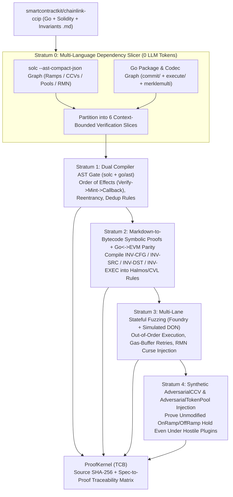

# Verification Methodology for Chainlink CCIP: Cross-Language Context-Sliced Proofs

> Companion to the interactive **[Chainlink CCIP Architecture Explorer](https://fredluv.github.io/chainlink-ccip-verification-architecture/)** ([`index.html`](./index.html)). This report specifies how to verify [`smartcontractkit/chainlink-ccip`](https://github.com/smartcontractkit/chainlink-ccip) across its **Solidity on-chain contracts, modular Cross-Chain Verifiers (CCVs), and Go off-chain OCR3 plugins** without solver explosion or context overflow.

---

## 1. Why Verifying Chainlink CCIP Is Distinctly Hard

Inspecting [`smartcontractkit/chainlink-ccip`](https://github.com/smartcontractkit/chainlink-ccip) reveals three realities that break naive verification setups:

1. **Cross-Language Split (Go Off-Chain + EVM On-Chain)**:
   - Off-chain consensus lives in Go (`libOCR3` **Commit** and **Execute** plugins in [`commit/plugin.go`](https://github.com/smartcontractkit/chainlink-ccip/blob/main/commit/plugin.go) and [`execute/plugin.go`](https://github.com/smartcontractkit/chainlink-ccip/blob/main/execute/plugin.go)), computing Merkle roots via `merklemulti` and fetching **RMN** signatures off-chain.
   - On-chain enforcement lives in Solidity ([`Router.sol`](https://github.com/smartcontractkit/chainlink-ccip/blob/main/chains/evm/contracts/Router.sol#L24), [`OnRamp.sol`](https://github.com/smartcontractkit/chainlink-ccip/blob/main/chains/evm/contracts/onRamp/OnRamp.sol#L31), [`OffRamp.sol`](https://github.com/smartcontractkit/chainlink-ccip/blob/main/chains/evm/contracts/offRamp/OffRamp.sol#L27), [`TokenPool.sol`](https://github.com/smartcontractkit/chainlink-ccip/blob/main/chains/evm/contracts/pools/TokenPool.sol#L40)).
2. **Modular Verifier Heterogeneity (CCVs)**:
   - [`OffRamp.sol`](https://github.com/smartcontractkit/chainlink-ccip/blob/main/chains/evm/contracts/offRamp/OffRamp.sol#L27) delegates cross-chain validity to pluggable CCVs under [`chains/evm/contracts/ccvs/`](https://github.com/smartcontractkit/chainlink-ccip/tree/main/chains/evm/contracts/ccvs): [`CommitteeVerifier.sol`](https://github.com/smartcontractkit/chainlink-ccip/blob/main/chains/evm/contracts/ccvs/CommitteeVerifier.sol#L24), [`SuccinctZKVerifier.sol`](https://github.com/smartcontractkit/chainlink-ccip/blob/main/chains/evm/contracts/ccvs/SuccinctZKVerifier.sol#L24) (SP1 Helios ZK light client), [`CCTPVerifier.sol`](https://github.com/smartcontractkit/chainlink-ccip/blob/main/chains/evm/contracts/ccvs/CCTPVerifier.sol), and [`LombardVerifier.sol`](https://github.com/smartcontractkit/chainlink-ccip/blob/main/chains/evm/contracts/ccvs/LombardVerifier.sol).
3. **Prose Invariants vs. Executable Proofs**:
   - The repo already documents nine thorough Markdown specs under [`chains/evm/contracts/invariants/`](https://github.com/smartcontractkit/chainlink-ccip/tree/main/chains/evm/contracts/invariants) (`CCV_INVARIANTS.md`, `MESSAGE_LIFECYCLE_INVARIANTS.md`, `TOKEN_POOL_INVARIANTS.md`, `FEE_INVARIANTS.md`, `AUTHORIZATION_INVARIANTS.md`, etc.) paired with Foundry attack/unit suites (e.g., [`OnRampTokenPoolReentrancy.t.sol`](https://github.com/smartcontractkit/chainlink-ccip/blob/main/chains/evm/contracts/test/attacks/OnRamp/OnRampTokenPoolReentrancy.t.sol)).
   - **The Gap:** Markdown invariants (`INV-CFG-*`, `INV-SRC-*`, `INV-DST-*`, `INV-EXEC-*`) are still human-read specs. A single subtle change in `_mergeCCVLists`, `MessageV1Codec`, or `commit/report.go` can violate an invariant without failing isolated unit tests, while whole-repo symbolic execution hits instant state explosion across ZK proof parsing, Go codecs, and multi-chain lanes.

---

## 2. Chosen Method: Cross-Language Assume-Guarantee Verification (5 Strata)

We partition verification along CCIP's natural **codec + verifier seams** (`ICrossChainVerifierV1`, `IPoolV2`, and `MessageV1Codec`) so every solver query and audit slice remains small, deterministic, and composable.

### Stratum 0 — Multi-Language Slicing (Defeating Context & State Explosion)

| Slice | Exact Source Files | Cross-Boundary Context Stub | Core Obligations |
|---|---|---|---|
| **1. Codecs, Fees & Rate Limits** | `MessageV1Codec.sol`, `ExtraArgsCodec.sol`, [`FeeQuoter.sol`](https://github.com/smartcontractkit/chainlink-ccip/blob/main/chains/evm/contracts/FeeQuoter.sol#L26), `RateLimiter.sol`, `CCVConfigValidation.sol` | None (pure/local state) | `ENCODING_INVARIANTS`, `FEE_INVARIANTS`, unique non-zero CCV validation |
| **2. Source Ramps & Custody** | [`Router.sol`](https://github.com/smartcontractkit/chainlink-ccip/blob/main/chains/evm/contracts/Router.sol#L24), [`OnRamp.sol`](https://github.com/smartcontractkit/chainlink-ccip/blob/main/chains/evm/contracts/onRamp/OnRamp.sol#L31), [`TokenPool.sol`](https://github.com/smartcontractkit/chainlink-ccip/blob/main/chains/evm/contracts/pools/TokenPool.sol#L40), [`Executor.sol`](https://github.com/smartcontractkit/chainlink-ccip/blob/main/chains/evm/contracts/executor/Executor.sol#L15) | Summarized `IPoolV2` & `IFeeQuoter` bounds | Sequence monotonicity (`INV-SRC-6`), `lockOrBurn` before `messageId`, `_mergeCCVLists` |
| **3. Pluggable CCVs** | [`CommitteeVerifier.sol`](https://github.com/smartcontractkit/chainlink-ccip/blob/main/chains/evm/contracts/ccvs/CommitteeVerifier.sol#L24), [`SuccinctZKVerifier.sol`](https://github.com/smartcontractkit/chainlink-ccip/blob/main/chains/evm/contracts/ccvs/SuccinctZKVerifier.sol#L24), [`CCTPVerifier.sol`](https://github.com/smartcontractkit/chainlink-ccip/blob/main/chains/evm/contracts/ccvs/CCTPVerifier.sol), [`LombardVerifier.sol`](https://github.com/smartcontractkit/chainlink-ccip/blob/main/chains/evm/contracts/ccvs/LombardVerifier.sol) | Abstracted `ISP1Helios` / external bridge state | Domain separation, signature quorum uniqueness, header-chain finality |
| **4. Destination Ramp & RMN** | [`OffRamp.sol`](https://github.com/smartcontractkit/chainlink-ccip/blob/main/chains/evm/contracts/offRamp/OffRamp.sol#L27), [`RMN.sol`](https://github.com/smartcontractkit/chainlink-ccip/blob/main/chains/evm/contracts/rmn/RMN.sol#L16), `RMNProxy.sol` | Abstracted `ICrossChainVerifierV1` & `CCIPReceiver` | `INV-DST-1..3`, permissionless execution state machine, RMN curse veto |
| **5. Off-Chain OCR3 Plugins (Go)** | [`commit/plugin.go`](https://github.com/smartcontractkit/chainlink-ccip/blob/main/commit/plugin.go), [`commit/validate_observation.go`](https://github.com/smartcontractkit/chainlink-ccip/blob/main/commit/validate_observation.go), [`execute/plugin.go`](https://github.com/smartcontractkit/chainlink-ccip/blob/main/execute/plugin.go), [`execute/outcome.go`](https://github.com/smartcontractkit/chainlink-ccip/blob/main/execute/outcome.go) | Mock chain readers / signers | Observation validation, BFT threshold aggregation, non-duplicate commit roots |
| **6. Go ↔ Solidity Parity Bridge** | `MessageV1Codec.sol` ↔ `pkg/types/ccipocr3/` + `merklemulti` | Fixed test vectors + FFI differential fuzzing | Exact bit-for-bit encoding, `messageId` hashing, and multi-proof verification |

---

### Stratum 1 — Dual Compiler AST Gate (`solc` + `go/ast`)

Before symbolic execution starts, deterministic AST visitors enforce structural invariants across both languages:
1. **Strict Phase Ordering in `OffRamp.executeSingleMessage`** ([`OffRamp.sol#L308`](https://github.com/smartcontractkit/chainlink-ccip/blob/main/chains/evm/contracts/offRamp/OffRamp.sol#L308)):
   - AST control-flow check verifies **CCV quorum validation precedes `releaseOrMint`** (`INV-DST-1`), and **`releaseOrMint` precedes `_callReceiver` / `ccipReceive`** (`INV-DST-2`).
   - Ensures token-only messages (`_isTokenOnlyTransfer`, [`OffRamp.sol#L421`](https://github.com/smartcontractkit/chainlink-ccip/blob/main/chains/evm/contracts/offRamp/OffRamp.sol#L421)) bypass `ccipReceive` (`INV-DST-3`).
2. **State Consumption Ordering in `OnRamp.forwardFromRouter`** ([`OnRamp.sol#L206`](https://github.com/smartcontractkit/chainlink-ccip/blob/main/chains/evm/contracts/onRamp/OnRamp.sol#L206)):
   - Verify sequence number mutation (`INV-SRC-6`) and reentrancy protections hold across external `lockOrBurn` calls into arbitrary `TokenPool`s.
3. **Go OCR3 Plugin Determinism (`go/ast`)**:
   - Statically flag non-deterministic map iteration in `Report` serialization (`commit/report.go`, `execute/outcome.go`) and ensure every `ValidateObservation` path enforces signature/RMN bounds before `Outcome` aggregation.

---

### Stratum 2 — Binding `chains/evm/contracts/invariants/*.md` to Bytecode Symbolic Proofs

Every named invariant ID in [`chains/evm/contracts/invariants/`](https://github.com/smartcontractkit/chainlink-ccip/tree/main/chains/evm/contracts/invariants) becomes an **executable symbolic obligation** checked against compiled bytecode (`Halmos` / `Certora CVL`):

- **From [`CCV_INVARIANTS.md`](https://github.com/smartcontractkit/chainlink-ccip/blob/main/chains/evm/contracts/invariants/CCV_INVARIANTS.md)**:
  - `INV-CFG-1..7`: Symbolically prove `CCVConfigValidation` rejects empty unions, zero addresses, and duplicates across `defaultCCVs` and `laneMandatedCCVs`.
  - `INV-SRC-1..13`: Symbolically prove [`OnRamp._mergeCCVLists`](https://github.com/smartcontractkit/chainlink-ccip/blob/main/chains/evm/contracts/onRamp/OnRamp.sol#L411) expands zero-address sentinels cleanly, never drops lane-mandated or pool-required CCVs, preserves user `ccvArgs`, and skips defaults on token-only sends unless explicitly requested.
- **From [`MESSAGE_LIFECYCLE_INVARIANTS.md`](https://github.com/smartcontractkit/chainlink-ccip/blob/main/chains/evm/contracts/invariants/MESSAGE_LIFECYCLE_INVARIANTS.md)**:
  - `INV-EXEC-4..9`: Symbolically prove across [`OffRamp.execute`](https://github.com/smartcontractkit/chainlink-ccip/blob/main/chains/evm/contracts/offRamp/OffRamp.sol#L188) that `SUCCESS` messages can never re-execute, failed executions never corrupt valid token releases (`_callWithGasBuffer`), and `SUCCESS` state is never committed prematurely when token delivery fails.
- **Assume-Guarantee Abstraction over ZK & Bridges**:
  - When verifying [`OffRamp.sol`](https://github.com/smartcontractkit/chainlink-ccip/blob/main/chains/evm/contracts/offRamp/OffRamp.sol#L27), abstract `SuccinctZKVerifier.verifyMessage` (`ISP1Helios` proof check) with a simple symbolic oracle returning `bool verified`; verify [`SuccinctZKVerifier.sol`](https://github.com/smartcontractkit/chainlink-ccip/blob/main/chains/evm/contracts/ccvs/SuccinctZKVerifier.sol#L24) separately against mock SP1 public inputs.
- **Go ↔ Solidity Differential Parity**:
  - Feed identical randomized `(sourceChainSelector, sender, receiver, data, tokenAmounts, ccvData)` structs through Go `commit` encoders and Solidity `MessageV1Codec` via Foundry FFI to guarantee zero bit-layout or padding mismatches.

---

### Stratum 3 — Stateful Multi-Lane Fuzzing & Failure Injection

Run continuous Foundry invariant campaigns over `Router -> OnRamp -> CCVs -> OffRamp -> CCIPReceiver` plus Go e2e tests ([`commit/plugin_roledon_e2e_test.go`](https://github.com/smartcontractkit/chainlink-ccip/blob/main/commit/plugin_roledon_e2e_test.go), [`execute/plugin_e2e_test.go`](https://github.com/smartcontractkit/chainlink-ccip/blob/main/execute/plugin_e2e_test.go)):
- **Out-of-Order Execution (`INV-EXEC-2`)**: Execute message `#5` before `#1` and `#3`; assert non-blocking independence and strict replay protection.
- **Gas-Griefing & OOG Retries**: Attach reverting or out-of-gas `CCIPReceiver` targets (`_callWithGasBuffer`) and verify state transitions to `FAILED`, tokens remain isolated per protocol rules, and retry transitions cleanly to `SUCCESS`.
- **RMN Global & Lane Curses (`RMN.sol#L39`)**: Flip `RMN.curse(subject)` between Commit and Execute phases and prove affected lanes/pools block token movement immediately.

---

### Stratum 4 — Synthetic `AdversarialCCV` & `AdversarialTokenPool` Injection + Proof Kernel

CCIP v2's defining extensibility claim is that **arbitrary token pools (`IPoolV2`) and selectable CCVs (`ICrossChainVerifierV1`) cannot corrupt protocol accounting or bypass lane security**:
1. **Compile `AdversarialTokenPool.sol`** (extending [`OnRampTokenPoolReentrancy.t.sol`](https://github.com/smartcontractkit/chainlink-ccip/blob/main/chains/evm/contracts/test/attacks/OnRamp/OnRampTokenPoolReentrancy.t.sol)) that attempts reentrancy during `lockOrBurn`, returns duplicate/zero addresses in `getRequiredCCVs`, or inflates `destPoolData`. Verify `OnRamp.sol` rejects or safely sanitizes every vector.
2. **Compile `AdversarialCCV.sol`** attempting to pass verification for unconfigured lanes or replay across chains; verify `OffRamp.ensureCCVQuorumIsReached` isolates quorum judgment cleanly per configured verifier set.
3. **Minimal `ProofKernel` Traceability Receipt**: Bind every invariant ID in [`chains/evm/contracts/invariants/`](https://github.com/smartcontractkit/chainlink-ccip/tree/main/chains/evm/contracts/invariants) directly to its AST check, Halmos/CVL rule hash, Go↔Solidity parity seed, and `.sol`/`.go` SHA-256 digests so every PR proves *which exact invariants remain covered*.

---

## 3. Why This Method Wins for Chainlink CCIP

| Alternative | Where It Breaks on CCIP | Why Our Context-Sliced Method Wins |
|---|---|---|
| **Markdown Invariants + Manual Audits** *(status quo)* | [`CCV_INVARIANTS.md`](https://github.com/smartcontractkit/chainlink-ccip/blob/main/chains/evm/contracts/invariants/CCV_INVARIANTS.md) and [`MESSAGE_LIFECYCLE_INVARIANTS.md`](https://github.com/smartcontractkit/chainlink-ccip/blob/main/chains/evm/contracts/invariants/MESSAGE_LIFECYCLE_INVARIANTS.md) are passive text; PRs touching `_mergeCCVLists` or `OffRamp` can drift from spec silently. | Turns every `INV-*` tag into a **CI-enforced bytecode & AST proof obligation** with source-hashed traceability. |
| **Solidity-Only Verification** | Ignores the Go off-chain OCR3 plugins (`commit/`, `execute/`), leaving **Go↔EVM encoding & `merklemulti` root parity** unverified. | **Stratum 0 + 6** explicitly slice both Go and Solidity and differential-fuzz the wire codec seam. |
| **Monolithic Whole-Repo Symbolic Execution** | Combining `OnRamp` + `CommitteeVerifier` + `SuccinctZKVerifier` (SP1) + `MultiTokenPool` + `OffRamp` triggers immediate SMT timeouts and huge LLM context overload. | **Assume-Guarantee cuts across `ICrossChainVerifierV1` & `IPoolV2`** keep every proof slice self-contained and fast. |
| **Testing Only Built-In CCVs & Pools** | Future integrations bring custom `TokenPool`s and third-party CCVs; testing only today's pools misses callback/reentrancy/config edge cases. | **Synthetic `AdversarialCCV` + `AdversarialTokenPool` injection** directly tests protocol safety against unseen extensions. |
